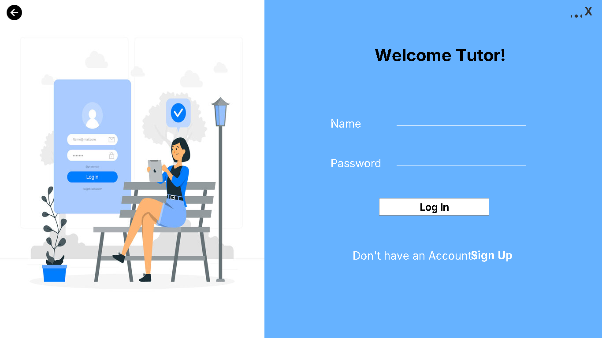
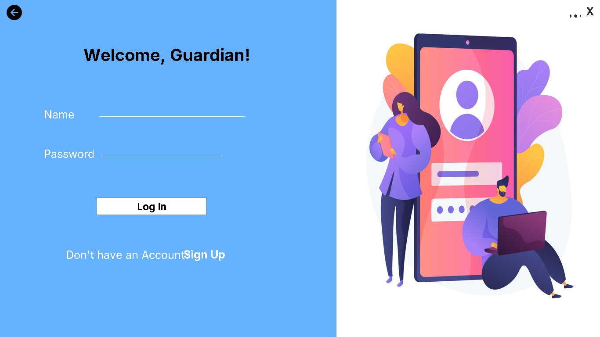
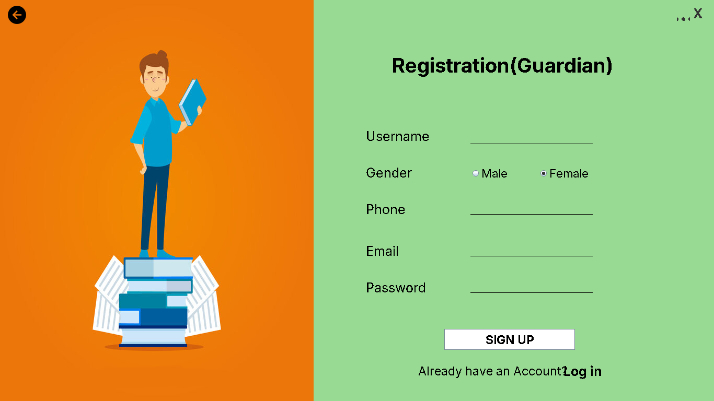
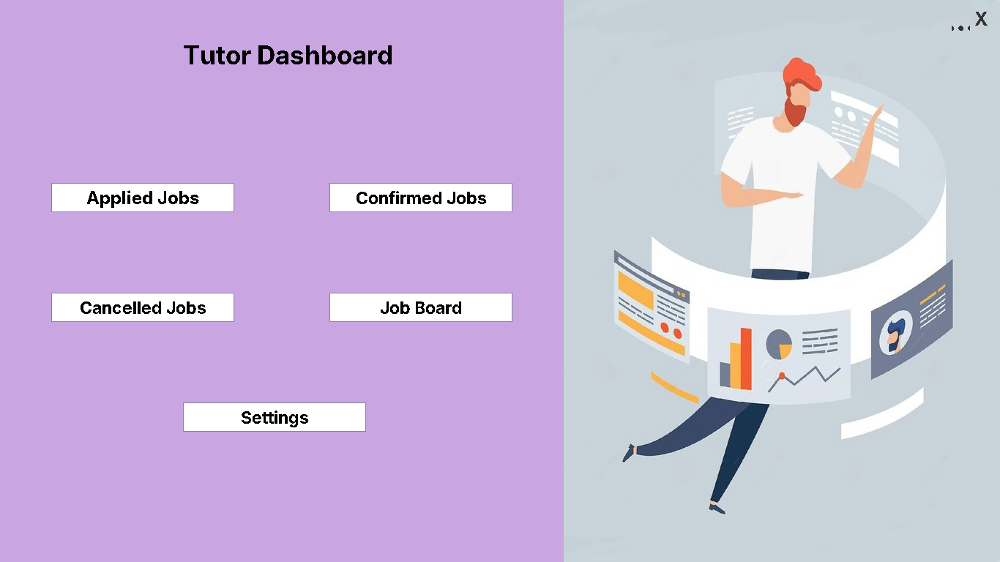
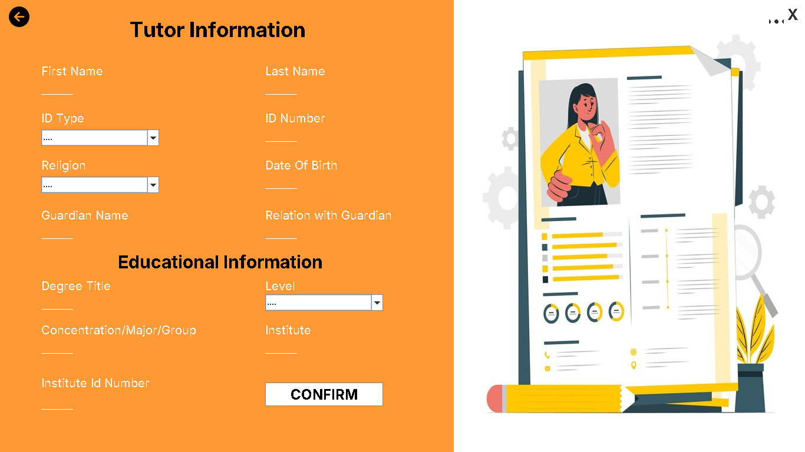
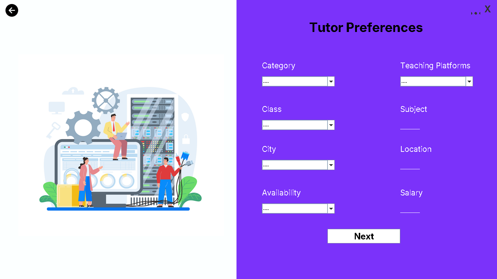
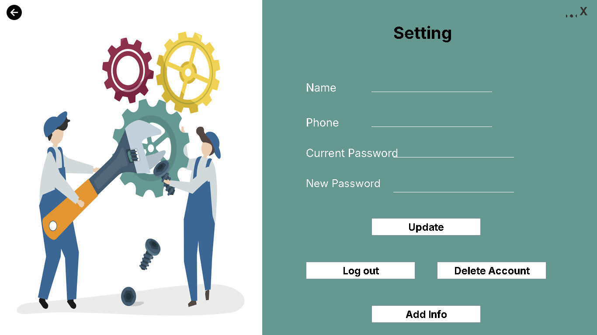
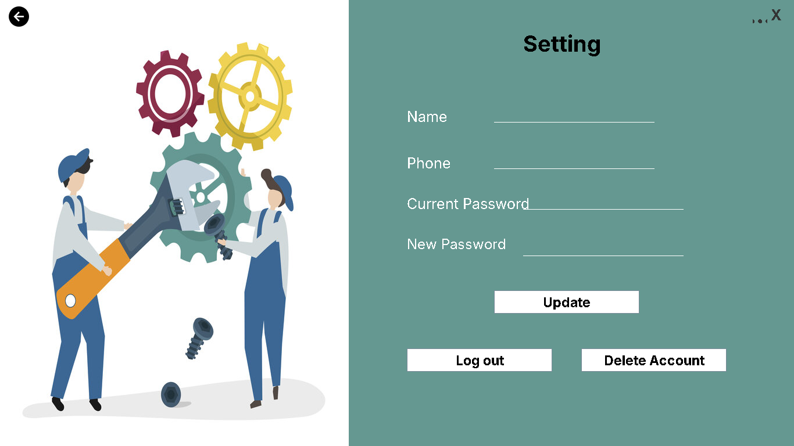

<div align="center">

# 📚 Tutor Seba

**A Java Swing desktop app that connects tutors with students and guardians.**


</div>

---

## About

**Tutor Seba** ("seba" means *service* in Bangla) is a desktop tuition-matching platform built with Java Swing.
It has two kinds of users:

- **Tutors**, who create an account and fill in their personal and educational profile.
- **Students and guardians**, who create an account and post tuition jobs with their requirements (class, subject, medium, location, schedule and salary).

Everything is stored in plain text files, so the app runs on any machine with a JDK. You don't need to set up a database.

## Features

### 👩‍🏫 Tutor
- Sign up and log in with a username and password
- Dashboard with Applied Jobs, Confirmed Jobs, Cancelled Jobs, Job Board and Settings
- **Add Info** form to build a tutor profile:
  - Personal details: name, ID type and number, religion, date of birth, guardian name and relation
  - Education: degree title, level, major/group, institute and institute ID
- Settings screen with log out

### 👨‍👩‍👧 Student / Guardian
- Sign up (username, gender, phone, email, password) and log in
- Dashboard with Posted Jobs, Confirmed Jobs, Cancelled Jobs, Post Tuition and Settings
- **Post Tuition** with tutor preferences:
  - Category: Bangla Medium, English Medium or English Version
  - Teaching platform: Online, Student's Home or Teacher's Home
  - Class: 1–9, SSC, O-Level, HSC or A-Level
  - Subject, city (Dhaka, Chittagong, Rajshahi, Barishal, Sylhet, Khulna), area, days per week and salary
- Settings screen with log out

### 🎨 Interface
- Borderless 1366 × 768 windows with custom close and minimise buttons
- Illustrated split-screen layout on every page
- Input validation with warning dialogs for empty fields
- In-app **Credit** screen listing the team

## Screenshots

| Tutor | Student / Guardian |
|:---:|:---:|
|  |  |
| Tutor login | Guardian login |
|  |  |
| Tutor registration | Guardian registration |
|  |  |
| Tutor dashboard | Guardian dashboard |
|  |  |
| Tutor information | Post tuition (tutor preferences) |
|  |  |
| Tutor settings | Guardian settings |

## Tech stack

| | |
|---|---|
| Language | Java (JDK 8 or newer) |
| GUI | Java Swing / AWT |
| Storage | Tab-separated `.txt` files via `FileWriter` and `Scanner` |
| Build | Plain `javac`, no external dependencies |

## Getting started

### Prerequisites
- [JDK 8 or newer](https://adoptium.net/) installed, with `javac` and `java` on your `PATH`
- A screen resolution of at least **1366 × 768**

### Run it

```bash
git clone https://github.com/Gaalib07/Tutor-Sheba.git
cd Tutor-Sheba
```

**Windows:** double-click `run.bat`, or run it from a terminal.

**macOS / Linux:**

```bash
chmod +x run.sh
./run.sh
```

### Run it manually

```bash
javac -d bin Start.java Classes/*.java
java -cp bin Start
```

> **Note:** always launch the app from the project root folder. Images are loaded from `Images/`, and the data files are created there too.

## Project structure

```
Tutor-Sheba/
├── Start.java              # Entry point: opens the welcome screen
├── Classes/                # Application package
│   ├── welcome.java        # Landing page: choose Tutor or Student/Guardian
│   ├── credit.java         # Team credits
│   │
│   ├── tlogin.java         # Tutor login
│   ├── tsignup.java        # Tutor registration
│   ├── tdash.java          # Tutor dashboard
│   ├── tsetting.java       # Tutor settings
│   ├── tinfo.java          # Tutor information / profile form
│   ├── taccount.java       # Tutor account model + file I/O
│   │
│   ├── Glogin.java         # Guardian login
│   ├── Gsignup.java        # Guardian registration
│   ├── Gdash.java          # Guardian dashboard
│   ├── gsetting.java       # Guardian settings
│   ├── preference.java     # Post tuition (tutor preferences) form
│   ├── gaccount.java       # Guardian account model + file I/O
│   │
│   └── tprf.java           # Tuition post & tutor profile model + file I/O
├── Images/                 # UI illustrations and icons
├── docs/screenshots/       # Screenshots used in this README
├── run.bat                 # Build & run (Windows)
└── run.sh                  # Build & run (macOS / Linux)
```

## How data is stored

The app creates these files in the project folder the first time they're needed:

| File | Contents |
|---|---|
| `Tdata.txt` | Tutor accounts: `username  phone  email  password` |
| `Gdata.txt` | Guardian accounts: `username  phone  email  password` |
| `tprefdata.txt` | Posted tuition jobs and tutor profile information |

These files hold user data, so they are listed in `.gitignore` and are not committed.

## Known limitations & future work

This was built as a university final project, so some parts are still to be done:

- [ ] Wire up the dashboard lists: Posted / Applied / Confirmed / Cancelled Jobs and Job Board
- [ ] Implement **Update** profile and **Delete Account** in Settings
- [ ] Hash passwords. They are currently stored in plain text.
- [ ] Store each job post and tutor profile on its own line in `tprefdata.txt`
- [ ] Match tutors to posted jobs by subject, location and class
- [ ] Move to a real database (e.g. SQLite or MySQL)
- [ ] Responsive layouts instead of fixed pixel positions

The UI uses the *Segoe UI* font. On systems without it, Java uses a fallback font, so the text may look slightly different.

## Team

| Name | ID |
|---|---|
| Hedayet Ullah Patwary | 22-47904-2 |
| MD Hasan AL Hussain Rifat | 22-47536-2 |
| MD Shafkat Manjur Deepto | 22-49014-3 |
| MD Sadikul Islam | 22-49036-3 |

## License

This project is licensed under the [MIT License](LICENSE).
